#  Inboxrake

[](https://github.com/mclgoerg/inboxrake/actions/workflows/ci.yml)
[](https://github.com/mclgoerg/inboxrake/releases)
[](https://scorecard.dev/viewer/?uri=github.com/mclgoerg/inboxrake)
[](https://www.bestpractices.dev/projects/14997)
[](LICENSE)

**Rake your mailbox into tidy piles.** Inboxrake is a self-hosted web app
that scans an IMAP mailbox, groups every mail by sender, subject or thread
with counts and sizes, and lets you trash, unsubscribe from or block whole
groups at once - with a preview first and Undo after.
**[Try the demo](https://inboxrake.com/demo/)** - it runs in your browser.
Optional AI review (Anthropic, OpenAI, Claude on Microsoft Foundry, or local
models via Ollama, LM Studio or vLLM) suggests what is safe to delete.

**[Website](https://inboxrake.com)** · **[Documentation](https://inboxrake.com/docs/)** · **[Try it in your browser](https://inboxrake.com/demo/)**

<p>
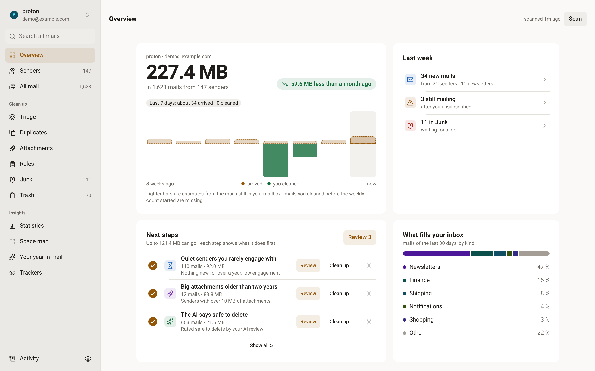
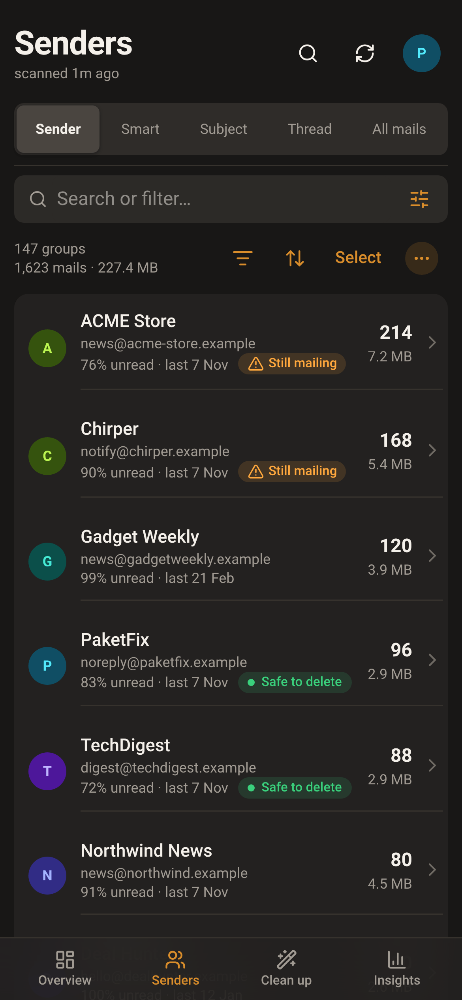
</p>

Overview (light) and Senders on a phone (dark) - the screenshots come from the
demo below.

**Nothing is deleted without asking.** Moves to Trash normally offer Undo
(the last 10 actions until restart). If the server cannot identify the moved
copies safely, restore them manually from Trash. **Permanent deletion** in Trash and Junk
cannot be undone:
the manual "delete permanently" actions confirm with exact counts, and
opt-in purge rules only act after you have reviewed a report run.

## Quick start

Needs Docker and an IMAP mailbox (Gmail, iCloud, Fastmail, Proton via
Bridge, ... - see [providers](#supported-providers)).

**Docker Compose** (the starter kit lives in [`deploy/`](deploy/)):

```bash
git clone https://github.com/mclgoerg/inboxrake
cd inboxrake/deploy
cp .env.example .env        # optional edits - account setup happens in the UI
# generate the key that encrypts stored passwords (before the first start)
sed -i "s|^INBOXRAKE_SECRET_KEY=.*|INBOXRAKE_SECRET_KEY=$(openssl rand -base64 32)|" .env
docker compose up -d
```

`INBOXRAKE_SECRET_KEY` encrypts the IMAP passwords and API keys stored in
`/data`; without it they are stored as plaintext and every start logs a
warning. Keep the key safe and out of your backups - if it is lost you
re-enter the secrets.

Open <http://localhost:8765>; on a fresh install a welcome screen and a short
setup walk you through provider, sign-in (folders are optional), an optional
login password and the first scan. For Proton Mail use
`docker-compose.proton.yml` instead (it needs a Bridge image you provide - see
its header).

**Plain `docker run`** with the published image:

```bash
echo "INBOXRAKE_SECRET_KEY=$(openssl rand -base64 32)" > inboxrake.env   # once; keep it
docker run -d --name inboxrake --env-file inboxrake.env \
  -v inboxrake_data:/data \
  -p 127.0.0.1:8765:8765 \
  ghcr.io/mclgoerg/inboxrake:latest
```

`:latest` follows `main` - every merge, so it can be ahead of the last
release. Pin `:2.0` (or an exact `:2.0.x`) to get release updates only.
Guides for Synology, Unraid, TrueNAS, Portainer and Raspberry Pi, the
host-folder ownership note (the image runs as user ID 1000) and every
environment variable are in **[docs/install.md](docs/install.md)**.

## Try the demo

The quickest look is the [live demo in your browser](https://inboxrake.com/demo/)
(fake mailboxes, nothing leaves the page). To run the same playground
locally - no account, no network:

```bash
git clone https://github.com/mclgoerg/inboxrake && cd inboxrake
docker run --rm -p 127.0.0.1:8765:8765 -v "$PWD":/repo \
  ghcr.io/mclgoerg/inboxrake:latest python /repo/scripts/demo.py
```

Add `--empty` to see the welcome screen and first-run setup instead (in the
setup any mail server name works and the password `demo` signs in).

**In action** - pick a quick filter, select the matches, confirm the
move to Trash (with the count spelled out), undo from the result toast, open
a sender beside the list:

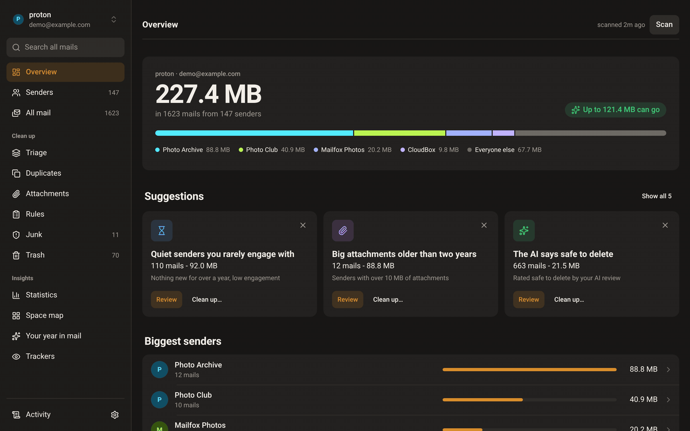

<details>
<summary>More screenshots - senders, space map, phone views, reader, year in mail</summary>

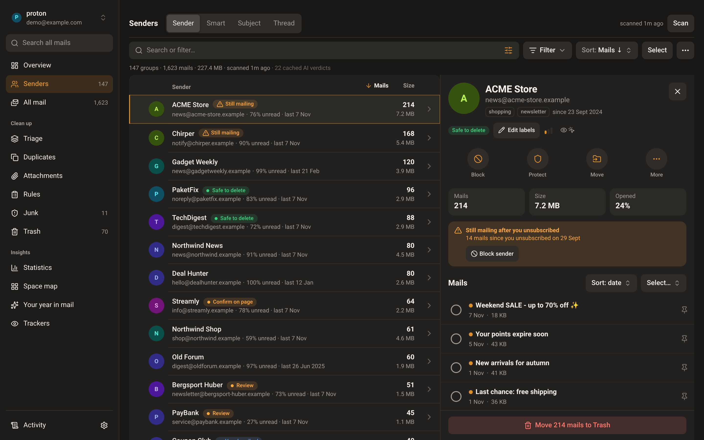
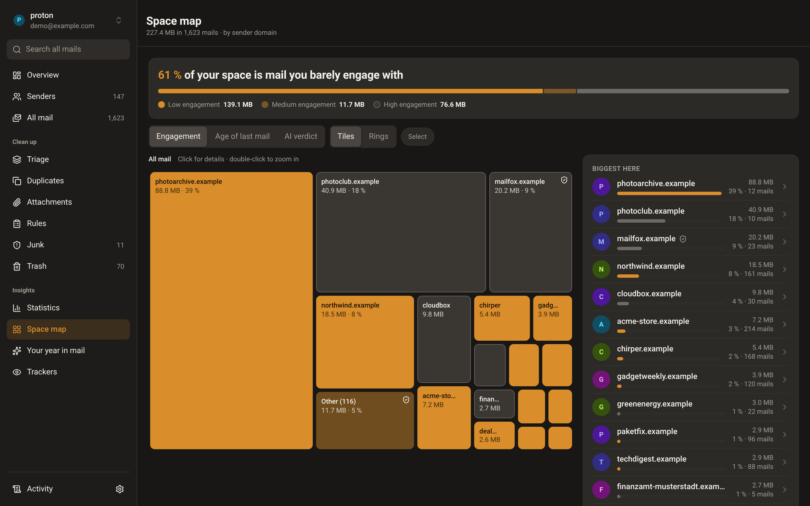
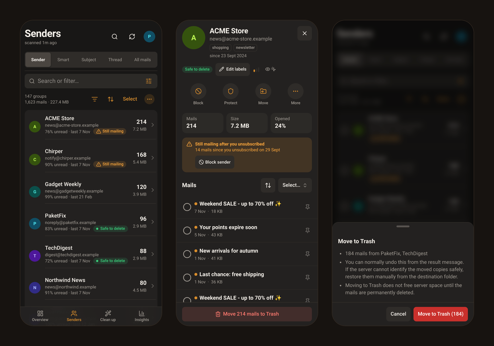

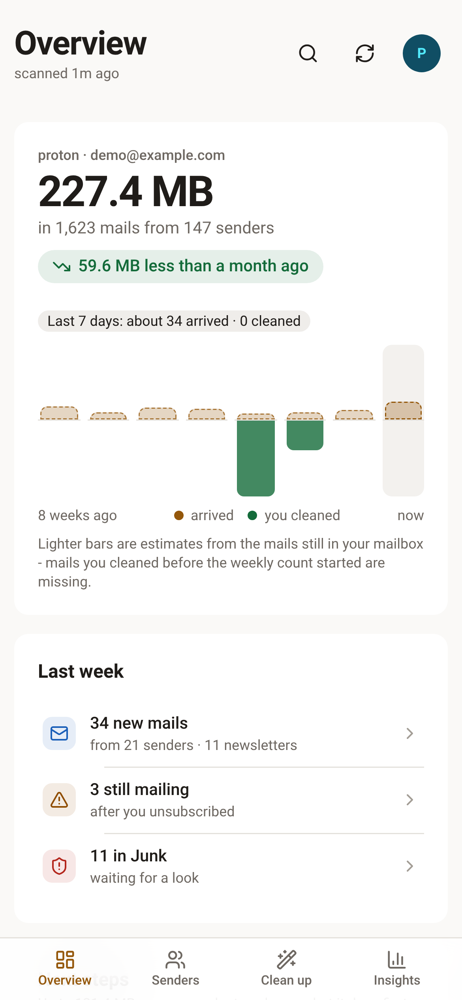
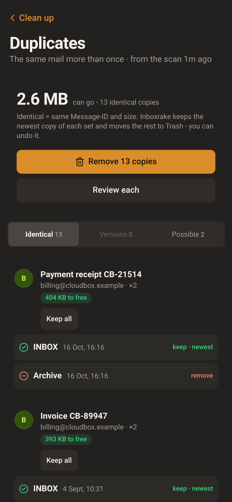
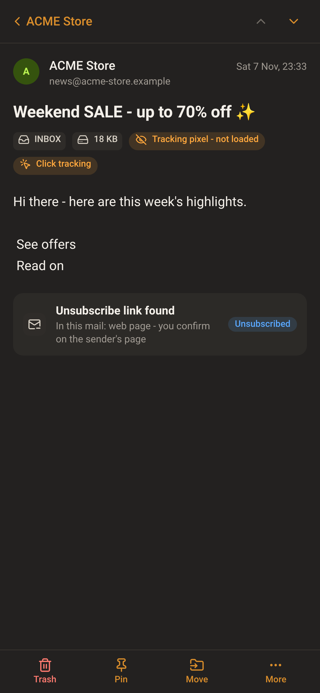
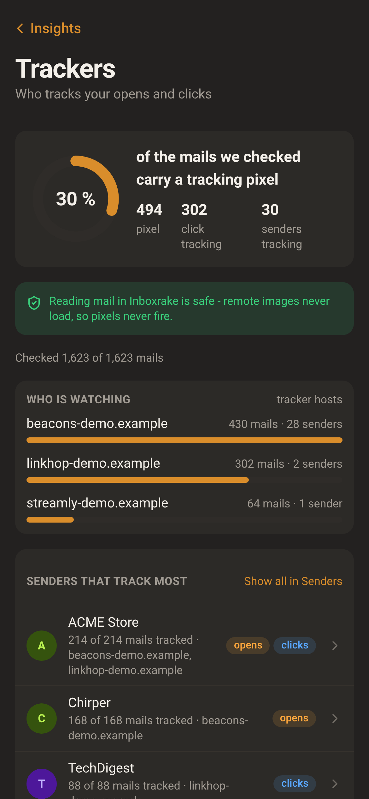
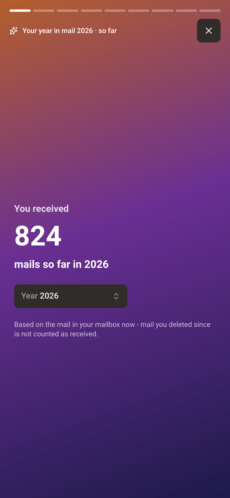

</details>

All screenshots show generated demo data (`scripts/demo.py`).

## Safety & privacy FAQ

**Does it delete anything without asking?** No. Trashing is an IMAP move to
the Trash folder, always behind a confirmation (with the count of mails; a
single protected group or pinned mail asks "anyway?" naming it instead),
with an Undo. UIDVALIDITY is checked before every move and
scans are read-only. Permanent deletion exists only as explicit actions in
Trash and Junk: the manual ones confirm with exact counts, and an opt-in
purge rule only acts after you have reviewed a report run (then it runs on
its schedule within its age limit and per-run cap). Rules and the
Folders-panel purges always skip protected senders and pinned mails. Moving
a protected group, or a single pinned mail, to Trash asks for an extra
confirmation; individual-message moves refuse protected senders until you
unprotect them in their group. **Empty Trash empties everything in Trash**, protected or not.
Rules also start in report mode.

**What leaves my machine?** Mailbox access goes to your configured mail
provider; unsubscribe actions contact the sender, and SSO contacts your
identity provider. Optional AI review sends only metadata (addresses, counts,
subject lines), never mail bodies or attachments. A local AI model (Ollama,
LM Studio, vLLM) keeps that AI traffic on your own network. The AI is optional, and you can set a
monthly budget in Settings -> AI. The UI loads no external assets.

**Why not just use filters or Sieve?** Filters work forward in time. Inboxrake
shows what already piled up - which senders, how many mails, how much space,
how much you actually read - so you decide in bulk, and can then block a
sender, unsubscribe or export a Sieve rule so it stays gone.

**How heavy is it?** One container: about 80 MB to download and roughly
55 MB of RAM while idle (measured on amd64 with the demo; a scan of a large
mailbox uses more while it runs). Images are published for amd64 and
arm64 (e.g. Raspberry Pi 4/5).

**Backup and uninstall?** Everything lives in the `/data` volume; Settings
-> Backup & restore has a settings export (it leaves out all passwords, tokens and API keys - you
re-enter them after a restore). Stop the
container and delete the volume to remove it. Your mailbox is never
modified by installing or removing Inboxrake.

**Is it safe to expose?** There is no login by default - keep the port on
localhost or behind an authenticating proxy, or enable the built-in password
or SSO login. Without a login it also answers only to `localhost` and IP
addresses; for a host name set `INBOXRAKE_ALLOWED_HOSTS`. Details in
[docs/security.md](docs/security.md).

More answers - why it needs your IMAP password, how it differs from other
tools, project status, Undo limits - in the
**[full FAQ](https://inboxrake.com/docs/faq/)**.

## Supported providers

Plain IMAP: special folders are found via SPECIAL-USE (RFC 6154) with a name
fallback, Gmail's "All Mail" is excluded, and servers without `MOVE` get a
COPY+EXPUNGE fallback. Each preset in Settings prefills host, port and
security; you add user and password.

| Preset | IMAP host | SMTP host (unsubscribe) | Auth notes |
|---|---|---|---|
| **Proton Mail Bridge** | `127.0.0.1:1143` SSL | `127.0.0.1:1025` | Featured setup: [`deploy/docker-compose.proton.yml`](deploy/docker-compose.proton.yml) and [Proton Mail via Bridge](https://inboxrake.com/docs/providers/#proton-mail-via-bridge). Paid Proton plan; use the Bridge-generated password and the exported Bridge certificate as CA file. |
| **Gmail** | `imap.gmail.com:993` SSL | `smtp.gmail.com:465` SSL | App password (2-Step Verification on) or OAuth - choose in Settings; see below. |
| **Outlook / Microsoft 365** | `outlook.office365.com:993` SSL | `smtp.office365.com:587` STARTTLS | OAuth only (Microsoft offers no app-password IMAP). **You register your own Entra app** (free, no shared client ships) - [steps](docs/install.md#microsoft-oauth-setup). |
| **iCloud Mail** | `imap.mail.me.com:993` SSL | `smtp.mail.me.com:587` STARTTLS | [App-specific password](https://account.apple.com/account/manage) required. |
| **Fastmail** | `imap.fastmail.com:993` SSL | `smtp.fastmail.com:465` SSL | [App password](https://www.fastmail.help/hc/en-us/articles/360058752854) with IMAP scope. |
| **GMX** | `imap.gmx.net:993` SSL | `mail.gmx.net:465` SSL | Enable IMAP in GMX mail settings first; app password if 2FA is on. |
| **mailbox.org** | `imap.mailbox.org:993` SSL | `smtp.mailbox.org:465` SSL | Normal password (or an app password). |
| **Yahoo Mail** | `imap.mail.yahoo.com:993` SSL | `smtp.mail.yahoo.com:465` SSL | [App password](https://help.yahoo.com/kb/SLN15241.html) required. |
| **Custom** | anything | anything | Any IMAP server with SSL or STARTTLS (Dovecot, Courier, …). |

- **Verified on real mailboxes:** Proton Mail (Bridge), iCloud, Gmail
  and GMX. The other presets use the same IMAP
  code and are covered by the fake-server tests; **Outlook / Microsoft 365
  is experimental** (fake-tested only).
- **Gmail OAuth** needs your own Google Cloud client. In Google's "testing"
  mode refresh tokens expire after 7 days - see
  [install.md](docs/install.md#gmail-oauth-setup); the app password avoids this.
- **Microsoft work/school tenants:** set `INBOXRAKE_MS_TENANT` (default
  `consumers`) - see [docs/security.md](docs/security.md#microsoft-tenant).
- The Sieve export is Proton-only and hidden for other presets.

## Features

An Overview start page with cleanup suggestions, five views (Sender, Smart
pools of small senders, Subject, Thread, all mails), a sender detail and a
mail reader that loads no remote content, a Filter menu and filter builder,
optional AI review and a "describe a filter" box, Triage, Duplicates,
Attachments, rules and a scheduler, one-click and bulk unsubscribe with a
watchdog, protected senders and mails, a Trash/Junk browser, trackers, space
map, statistics, "Your year in mail", audit log, multiple strictly separate
accounts, system/light/dark appearance, phone layout, English and
German. Everything is listed in **[docs/features.md](docs/features.md)**.

## Security & multi-user

- No login by default; password or any OpenID Connect provider (SSO) is
  built in, with a login throttle, sign-out of every browser when the login
  changes, and refusal of SSO identities with an unverified email.
- With SSO every identity gets its own isolated workspace; an empty
  allow-list admits any account at the provider.
- `INBOXRAKE_SECRET_KEY` encrypts stored secrets (IMAP passwords, API keys,
  tokens), so those secrets in a copied volume backup are unreadable
  without it.
- The container runs as a non-root user; CI runs CodeQL and a dependency
  review.

All of it is in [docs/security.md](docs/security.md); vulnerabilities go to
[SECURITY.md](SECURITY.md), not a public issue.

## Development

```bash
# backend
pip install -r backend/requirements-dev.txt
uvicorn backend.main:app --port 8765 --reload
# frontend (proxies /api to :8765)
cd frontend && npm install && npm run dev
# tests - no mail server or network needed (fake in-memory IMAP server)
python -m pytest tests/ -q
```

FastAPI backend, React + TypeScript + Tailwind frontend. Read
[CONTRIBUTING.md](CONTRIBUTING.md) first. English and German live in
`frontend/src/locales/`.

## AI disclosure

Inboxrake was built with AI assistance (Anthropic's Claude via Claude
Code), directed and reviewed by the maintainer. It was used on real
mailboxes at Proton, iCloud, Gmail and GMX; Outlook support has only been
tested against a fake server. Independent of how the code was written, the
safety properties are enforced by tests: deletions are reversible moves
(except the explicit, count-confirmed permanent-delete actions in Trash and
Junk and purge rules), UIDVALIDITY is checked before every action, and the
optional AI review only ever receives mail metadata - never message bodies.

## License

[MIT](LICENSE)
