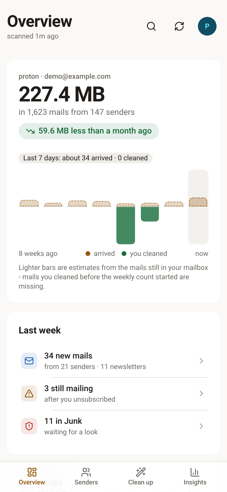
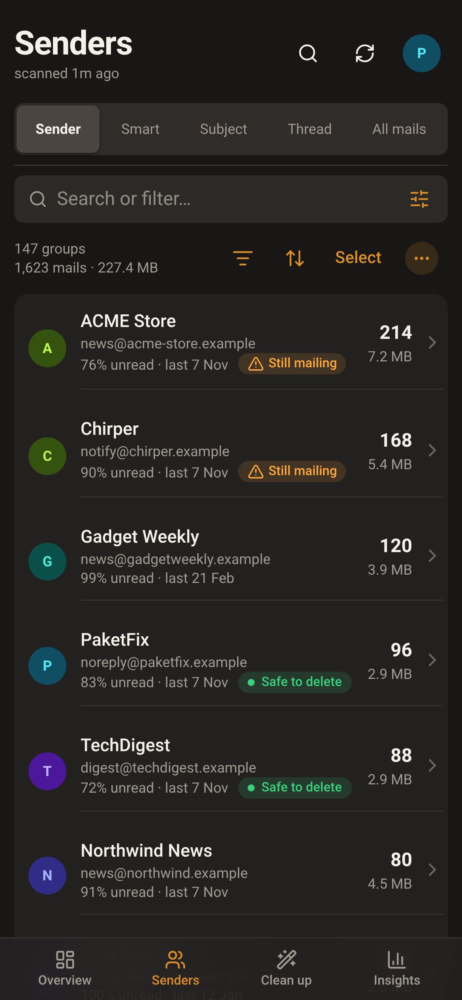
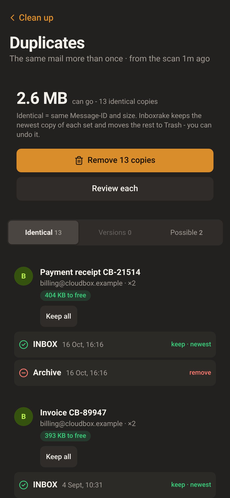
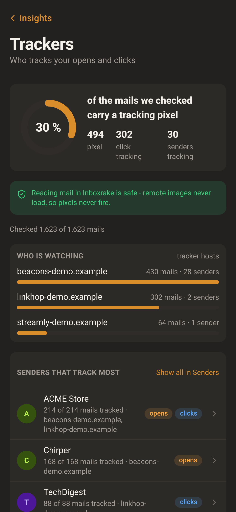
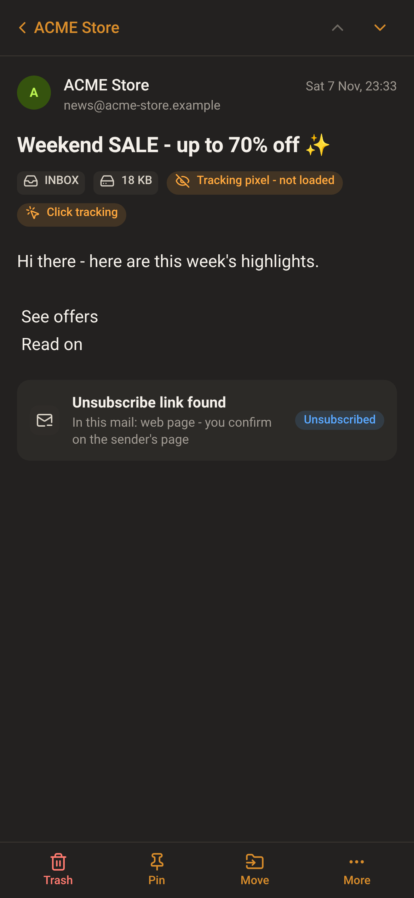

# Features

Everything Inboxrake can do, by area. Each area starts with a screen from the app; the features follow, each with where to find it.

The [README](../README.md) has the short version; [Install](install.md) covers running it and [Security & privacy](security.md) the login, multi-user and secrets options.

<nav class="area-chips" aria-label="Areas">

- [Overview & navigation](#overview--navigation)
- [Senders & mails](#senders--mails)
- [Clean up](#clean-up)
- [Insights](#insights)
- [Rules & automation](#rules--automation)
- [AI (optional)](#ai-optional)
- [Safety](#safety)
- [Settings & more](#settings--more)

</nav>

## Overview & navigation

Everything you see first, and how you move around: the Overview, the sidebar and tab bar, search, accounts, phone gestures.

### Overview

<small class="where">Overview</small>

The start page and a balance of the active account (accounts
are never mixed): the main card shows size, mails and senders, how the size
changed against a month ago and an 8-week chart of mails that arrived versus
mails you cleaned (lighter bars are estimates from the mails still in the
mailbox). Beside it a **Last week | Since last visit** card (new mails, new
senders, senders still mailing after you unsubscribed, mails in Junk, new AI
verdicts), "Next steps" (the [Suggestions](#suggestions)), "Biggest
senders" with a storage bar and "What fills your inbox" (the last 30 days by
kind). Everything else is one click away in the sidebar (on screens 1024 px
and wider) or the tab bar at the bottom (phones and tablets: Overview,
Senders, Clean up, Insights). A fresh load without a route in the address opens on the Overview.

### Sidebar and tab bar

<small class="where">Sidebar (1024 px and wider) · tab bar (phones, tablets)</small>

On screens 1024 px and wider a sidebar holds the
account switcher, "Search all mails", Overview, Senders, All mail, **Clean up**
(Triage, Duplicates, Attachments, Rules, Junk, Trash, Snoozed), **Insights**
(Statistics, Space map, Your year in mail, Trackers, Subscriptions, Your addresses, Waiting for a reply) and, at the bottom,
Activity and Settings. Junk, Trash and Snoozed show their mail counts. On wide screens
each tool opens as a page in the content column next to the sidebar (and has
its own address, e.g. `#/triage`, so reload and the browser's Back / forward
keep you there); below 1024 px they open as a window (full
screen on phones). Tool pages have a large title and a back link on phones.
On phones and tablets the same things sit behind a bottom
tab bar (Overview, Senders, Clean up, Insights); the Clean up and Insights
tabs are pages with a tile per tool and a glance at its last result, and
search and the account menu (your avatar) are in the top bar. AI review and
Export CSV live in the Senders toolbar's
More (…) menu; once something is selected they scope to the selection,
otherwise they act on everything.

### Search

<small class="where">Search all mails (sidebar) · magnifier (phone top bar)</small>

Shows matching senders and mails as you type (from two
characters), with a **Recent** list (kept in this browser only) and ready-made
"Try" searches with their live counts (big attachments, unread for over a
year, people you replied to, older than 5 years) that open Senders with the
matching filter. Scope: "Subject & sender" or "Also mail text" (see "Local
mail-text search index" below for how that is searched); results can be
narrowed by time and folder, selected and moved to Trash with the usual
confirm, and a mail opens in the reader. At most the newest 500 matches are
shown.

### Multiple accounts

<small class="where">Account switcher (top of the sidebar, avatar on a phone)</small>

Connect several providers at once (e.g. Proton
Bridge + Gmail). Every account is strictly separate: its own scans, groups,
rules, saved presets, digest settings, statistics, folder exclusions,
duplicate and label choices and replied/verdict/known-senders caches - nothing
is ever mixed, and nothing is ever *done* to two accounts at once (the
read-only [All accounts](#all-accounts) views only look across them). The
account switcher (top of the sidebar; the
avatar on a phone) shows a card per account with its sign-in state, last scan,
mails and size and switches the whole view between accounts; a card whose
sign-in is broken leads straight to that account's settings. It also holds
"Add account" (always the setup wizard, also from Settings), Appearance and
the links to Activity and Settings. Accounts can be renamed (all their data
follows) and removed in settings, and each has its own folder-discovery
picker.

### All accounts

<small class="where">Account switcher → All accounts · Overview, Senders, All mail, Search</small>

With two or more accounts the account switcher gets **All accounts** on top
(stacked avatars, "N mailboxes"). The choice is remembered like the current
account. The Overview then shows every mailbox side by side: a card per account
with its size, mails, how many mails are **new** since your last visit (the last
week when there was none before), when it was last scanned (a failed scan in
orange), one bar for where the space is, and **Same sender, several
accounts** - the newsletters and shops that write to more than one of your
addresses. Senders are matched by exact sender address first, then by the
company domain (never freemail or shared platform hosts: a `gmail.com` sender is
only matched by its full address); protected senders and people you wrote to
are left out. **Open an account** from its card (on a phone: the account chips
above the widgets, All plus each account).

**Unsubscribe in N…** opens one confirm that lists each account with its own
checkbox, the address and method it would use there (one click, a mail, a
page) and how many mails it covers. "Also move the N mails to Trash" is off by
default; ticked, the confirm is the danger kind (verb and count, the keep-safe
check of big moves) and each account moves that sender's mails only after *its*
unsubscribe is done (protected senders and pinned mails stay). Then one step
runs **per account**, one after the other: each is recorded in that account's
Activity with its own Undo, an account whose step fails does not stop the
others and is reported, and an unticked account is never touched. If the list
of accounts changes while the confirm is open, an account that is gone is
skipped and said so.

**Scan all** scans every mailbox one after the other (an account that is busy
with another job is left out and named). Only your own accounts are ever
listed: with several users (SSO) each person sees only their workspace. The
numbers come from what each account's last scan already holds, so opening the
page contacts no mail server.

**Senders, All mail and Search** read across the accounts too. The Senders page
has **one row per sender address**: the same address in several accounts is a
single row with its mails summed and a chip per account (its mails there); the
filter, the sort and the select-all-matches work over the union, and the
account chips above the list narrow it to one account's side of every row.
A sender's detail lists the accounts it is in - each with its own numbers,
its protection and its **own grade** (grades are worked out per account, so the
row itself shows none, and there is no grade sort or `grade:` match here) - and
**Open in** *account name* takes you to that account's own detail, where everything
that belongs to one account lives: Move to a folder, Protect, Block, labels, the
grade's six checks, limits. **Show the mails** opens All mail for that sender
across the accounts. All mail and Search show an **account badge on every
row**; All mail can be narrowed to one account, Search has an account select,
and a mail opens in its reader with every call going to *its* account (the
reader offers no Move, sender page or Block here - those are per account).

What you do with a selection goes through the same multi-account confirm:
**Move to Trash**, **Archive** and **Mark as read** (and, for one sender at a
time, **Unsubscribe in N…**) list each account the selection reaches with its
own checkbox and count, then run one step per ticked account - the account's own
background job with its own Undo and Activity entry. The single-account rules
hold per account: protected senders are left out of a Trash, pinned mails stay,
a big move to Trash asks the keep-safe question for that account. An account
whose step fails does not stop the others and is reported, an unticked account
is never touched, and no keyboard shortcut (j / k / x / #) works on the lists
across accounts - nothing is ever done to an account you did not see named.
What works on one account at a time - Rules, Junk and Trash, the tools,
Activity - shows **Pick an account** with the account list while All accounts is
selected; Settings opens as usual.

### Move to another account

<small class="where">Settings → an account → Move to another account…</small>

Switching providers, or merging two mailboxes: copy what matters from one of
your accounts into a new folder of another (named `From <account name>` by
default, editable). Step 1, *What to bring*, lists the Smart kinds with their
mails and sizes - people you write to, orders, account mail, bookings,
protected senders and pinned mails are ticked, newsletters and the rest are
left behind - and sums them up (a mail in two kinds counts once) next to the
free space of the target when its server reports a quota. Step 2, *Copy*,
runs on the server like a scan, with progress, Pause / Resume / Cancel, and
carries on after a restart without copying a mail twice. Every mail keeps its
date, read / unread, starred and answered flags; a mail already in the
target (same Message-ID - or, for a mail without one, the same date, size and
subject) is skipped, mails over 50 MB are skipped and reported, and each batch
is checked in the target afterwards. The new folder is created where the
target's server wants folders; a folder the server uses for something else
(Inbox, Trash, Junk, Sent, Drafts, Archive - in any language) is refused, an
existing ordinary folder is added to. Two accounts that are one mailbox (the same
server and login, or an alias the copy recognises by a read-only look at both
Inboxes before it writes anything) cannot be copied between. The copy only
reads the source: nothing is deleted, moved or marked read there - the
originals stay until you clean up with the usual tools. Step 3, *Tell them*,
lists the senders that still wrote to the old address in the last 90 days as
a checklist; newsletters lead to the unsubscribe review of the old account
instead. Mail only travels between your own servers; both accounts must belong
to you (the same user), and each copy is recorded in the Activity log (counts
only).

### Phone layout

<small class="where">Phones</small>

The same app on a small screen: touch-sized controls, a
bottom tab bar, filters and confirmations as bottom sheets, a compact list.

### Gestures on phones

<small class="where">Phones and tablets</small>

Swipe a sender row left for Trash (a full swipe),
Block and More, right for Protect, Read and Not now; swipe a mail row left for
Trash, right for Pin, Read and Not now. Every swipe action asks the same confirmation as its
button. Below 1024 px (phones and tablets), pull down from the top of Overview, Senders or All mail to scan
(the header shows the scan's progress). Sheets close with a swipe down. In the
installed app (PWA), where no browser chrome answers it, a swipe from the
left edge goes back from a tool page, a sender or a Settings section.

### Back closes overlays

<small class="where">Below 1024 px</small>

Below 1024 px every full-screen window, bottom
sheet and opened mail or conversation takes one browser-history step while
it is open, so the browser's Back, Android's system Back and Safari's back
swipe close the top-most one and land on the page underneath instead of
leaving the app.

### Fast to open

<small class="where">Every start</small>

Each account's last scan is cached on disk and shown
instantly after a restart or account switch (with its age); a rescan
refreshes it. Live updates stream only small status deltas - the full
group list is re-fetched just when it actually changed.

## Senders & mails

The core of the app: the list of senders (or subjects, or threads), what each row tells you, and what you can do with one sender or one mail.

### Views

<small class="where">Senders → grouping control</small>

Five of them: Sender, Smart (every big sender keeps its own row;
the long tail of small senders is pooled by company - all `noreply@`,
`news@`, … of one domain - and by what their mails are about: orders &
deliveries, appointments & bookings, job applications, support & inquiries,
accounts & security, newsletters, people you write to, …, so hundreds of
rows become ~50. A company row says what its mails are about; open a pooled
row to see its senders and act on just some of them. The per-account
threshold is "Own row from N mails", default 10), Subject (normalized:
merges `Order 123` / `Order 456`, strips Re:/Fwd:), Thread (whole
conversations) and a flat "All mails" list. The grouping control sits in the
Senders toolbar; "All mail" is its own sidebar item on wide screens. The
grouping starts at Sender.

### Cleanup signals

<small class="where">Senders → every row</small>

Mail count, total size (find attachment hogs),
unread percentage, first->last date range (short dates, e.g. "7 Oct"), category tags
(shipping, finance, shopping, social, travel, newsletters,
automated…).

### Sender detail

<small class="where">Senders → open a sender</small>

Every mail of a group with date/size/unread, per-mail
selection and deletion ("Trash selected", or "Move N mails to Trash" for the
whole group, the button at the bottom). Under the name sit the figures
(Mails, Size, Opened), the sender's signals (new, replied, protected,
blocked, how it is unsubscribed) and the actions for the sender as a whole:
Unsubscribe (when the sender offers it), Block, Protect, Move (all of the
sender's mails to a folder, with the same confirm, protected-mail handling
and Undo as moving selected mails), **Edit labels** and a More menu (rate
with AI, read the conversation, protect all mails of the group, Sieve
export). Mails sort by date or size, and a "Select…" menu picks all
or none or the mails older than 6 months / 1 year / 2 years. On screens
1280 px and wider the group opens in a **side pane** next to the list, so
you can keep scanning the list while you read; below that it is a dialog
(full screen on a phone).

### Edit labels

<small class="where">Sender detail → Edit labels</small>

In a sender's detail: set its AI verdict (Safe to delete /
Review / Keep) and its categories yourself, and see or change how it is
filed in Smart. Your choice wins over the AI and over the keyword rules,
survives rescans and shows as "set by you"; "Reset to automatic" puts verdict
and categories back. A protected sender is still never "safe to delete" and
a row that contains a sender you put on hold is never offered as AI-safe.
Your labels are part of the settings backup.

### Mail reader

<small class="where">Sender detail · Search → open a mail</small>

A mail opens like in a mail app: sender, readable date, a
big subject, chips for attachments and tracking, quoted history folded away
("Show quoted text") and, when the mail carries an unsubscribe link, a card
that says how it unsubscribes. The body is always plain text: HTML is
converted, no remote content is loaded and no tracking pixel fires. A
toolbar acts on the open mail: Trash, Pin, Move, Conversation and a More
menu (Open sender, Copy address, Show headers, Block sender); previous / next
arrows walk the list you came from. **Conversation** shows the whole thread
as cards, oldest first, with your own replies from Sent marked "from Sent";
a card's text is fetched when you expand it. Mails in Sent are read-only.

### Selection bar

<small class="where">Senders → Select</small>

A floating capsule at the bottom, there only once
something is selected: how many groups and mails you picked, Clear
selection, Unsubscribe, Archive, Move, **Not now**, a More menu (Mark read, AI review,
Export CSV, "Limit to…" - the retention limiter, shown as a removable token
while active) and the **Trash N** button. Tick rows with **Select** in the
Senders toolbar (round checkboxes appear until you press Done; on a wide
screen they also show when you hover a row, on a phone only in Select mode),
or press `x` on the focused row. Destructive actions ask first in an in-app confirmation
that names what they affect (e.g. "618 mails from 6 groups will be
affected"), mentions skipped protected senders and mails, and focuses
Cancel; on a phone it is a bottom sheet.

### Filter menu

<small class="where">Senders → Filter</small>

The Filter button in the Senders toolbar (a sheet on
phones) holds the one-tap filters: quick filters (AI-safe groups, Not yet
unsubscribed, plus New senders and Still mailing when there are any),
**Inactive for: 6+ months | 1+ year | 2+ years**, your saved filters,
"Save current filter…", "Build a filter…" and "Describe a filter (AI)…".
Each row shows how many groups it matches. The Filter button lights up and the
active filter shows as a removable token next to the filter box; filters never
combine - use the filter box for that. Pick a filter to apply it, pick it
again to switch it off. While a filter is active, a **Select all N matches**
bar tops the list: it selects every match (across all pages; protected
groups stay unselected and are counted), and once they are all selected it
reads "All N matches selected" with a Clear that un-selects exactly those.

### Filter builder

<small class="where">Senders → sliders button</small>

The sliders button next to the filter box (Senders
toolbar) opens a click-together builder (category, AI verdict, age, unread
%, attachments, flags such as "not yet unsubscribed" or "rarely engaged
with"); on phones it opens as a bottom sheet. It writes the same filter
syntax you can type, and the result can be saved as a preset.

### Saved filters

<small class="where">Senders → Filter → your saved filters</small>

Save the current filter query under a name and
recall it with one tap from the Filter button's menu (a sheet on phones),
next to the built-in quick filters; edit a saved preset's query later with the same filter builder, or
delete it. Account-scoped like everything else.

### Sort menu

<small class="where">Senders → sort control</small>

The sort control next to the filter box (an icon on phones)
opens a menu with "Sort by" (the columns of the list) and "Order"
(Ascending / Descending); the column headers still toggle with one click.
The mail lists use the same menu pattern for Date / Size.

### New senders

<small class="where">Senders → Filter → New senders</small>

A sender new to the mailbox since your last few
scans gets a 🆕 badge and shows up under a one-tap "New senders" entry in the Filter
menu (`is:new`), so it doesn't get lost among a thousand others - block,
protect or unsubscribe right from there. Purely a read-only signal (first
scan seeds silently, nothing is ever auto-actioned); the window it stays
flagged for (default 7 days) is configurable in settings.

### Never replied signal

<small class="where">Senders → every row · filters</small>

Each scan also reads the To/Cc headers of
your Sent folder (headers only, cached across scans): groups you have
written to get a ↩ replied tag, filter with `is:replied` /
`is:noreply-ever`, and the AI leans towards keeping senders you actually
correspond with.

### Engagement score

<small class="where">Senders → every row</small>

Every group gets a 0-100 score for how much you
actually engage with it, computed locally from what a scan already
knows: the share of its mails you read (the backbone), a strong boost if
you have written to its senders, a damping factor for newsletters/bulk
mail, and a fade for senders that have been silent for months. It shows
as a small three-step meter on each row (tap or hover for the breakdown), sorts
via "Sort: engagement", and filters with `eng:low` / `eng:medium` /
`eng:high` (tiers <=33 / 34-66 / >=67) - usable in rules and saved
presets, e.g. `eng:low age:>1y`. The score is never sent to the AI.

### Sender grade

<small class="where">Senders → every Sender row · Statistics</small>

Every sender gets a grade from A to F and one plain sentence ("loud and
ignored", "quiet and useful", "tracks you, but you read it"), shown as a
badge in the Senders list and as a report card at the top of the sender
detail. The card lists six checks with their value, a note and a
✓ / ✗ / –, so the grade is never a black box: how much of the sender's mail
you read, how often it mails, tracking (from the local body index, "not
checked" without it), a one-click unsubscribe header, whether it stops after
you unsubscribed (the watchdog) and the average mail size. Each good sign is
+1, each bad one -1, a sender that keeps mailing after you unsubscribed
counts -2; 3 points or more is an A, 2 a B, 0-1 a C, -1 to -2 a D and -3 or
less an F. People you have written to never grade below C. The weights are
fixed in the app and printed under "How grades work"; there is no AI and
nothing leaves the server. Sort the list with "Grade · worst first", filter
with `grade:d`, `grade:<=c` (C or worse) or `grade:>=b` (B or better) - also
in rules and saved filters - and see how your senders spread over A-F, and
how much mail the D and F senders send, in Statistics ("Show them" opens the
list filtered to them). Grades are for the Sender view; a grade never acts on
its own, and protected senders and pinned mails stay out of every cleanup as
before.

### Filing senders in Smart

<small class="where">Senders → Smart → pooled row</small>

Tick senders in a pooled row and choose
"File in Smart as…" (a kind, or one of your own categories) to decide
where a sender - or its whole company - belongs. It only places the
sender: no mail is moved, it is remembered (per user, on your server
only, never sent to an AI), undoable, and a sender's detail view shows
how it is filed and why. After an AI sorting run you can keep its answers
as your own rules too; clearer mail still wins over a kept answer.
Settings -> Filed senders lists everything Inboxrake knows this way as a
grouped list - searchable, filterable (All / By you / AI / Unused), with
"Change group" and "Forget" per entry and, in the "…" menus, "Remove unused",
the AI-answer actions, sorting (Sort by / Order) and download / upload of
just this list.

### Moving mails (folder picker)

<small class="where">Move (sender, selection or opened mail)</small>

Every Move (a sender's mails, selected
mails, one opened mail) uses a searchable folder list with mail counts and
your folder hierarchy; "Suggested" offers your Archive folder and the folders
you moved to recently (remembered per account in this browser, and only once a
move really went through). It is a popover on wide screens and a bottom sheet
on phones. When you move everything from one sender or domain you can switch
on **Always move new mail from <sender> here**: after the move this creates a
rule (manual schedule: it runs only when you run it) that starts in report
mode, so nothing is moved automatically until you arm it in Rules.

### Keyboard shortcuts

<small class="where">Senders (wide screens)</small>

On the Senders page (grouped views), `j`/`k` (or
↑/↓) move through the list, `Enter` or `o` opens the group, `x` selects it,
`#` trashes the selection (or the focused group; it still asks first), `/`
jumps to the filter box and `Esc` closes the side pane. In the All mails
view only `/` and `Esc` apply.

## Clean up

The tools that remove mail: suggestions, swipe triage, copies, attachments, Trash and Junk, and unsubscribing.

### Suggestions

<small class="where">Overview → Next steps</small>

After a scan, the Overview's "Next steps" suggest a few cleanups (old
newsletters you never open, quiet low-engagement senders, mail from senders
you already unsubscribed from, big old attachments, what the AI rated safe)
with how much each frees. Review opens the Senders page with the step's
filter in the box and its matches selected ("Review N" in the header does
that for the steps you ticked); Clean up goes straight to the
usual Trash confirm (protected senders skipped, Undo afterwards); the x
("Not now" on phones, in the More menu) hides a step until a later scan finds
25 % more.

### Swipe triage

<small class="where">Clean up → Triage</small>

Triage (sidebar: Clean up; phones: the Clean up tab)
deals out the groups of the current list as a stack of cards: swipe left to
Trash, right to Keep, up to Unsubscribe - or use the round buttons or the
arrow keys; a running tally shows your decisions and "Undo last decision"
takes the previous card back. Nothing happens while you decide; at the end
one confirm names every decision, then protects, unsubscribes and trashes
(with the usual Undo).

### Duplicates

<small class="where">Clean up → Duplicates</small>

Opens with one number
and one button: **Remove N copies** keeps the newest copy of every identical
set and moves the rest to Trash through the usual confirm and Undo (sets that
contain a pinned mail or a protected sender are left alone and counted).
**Review each** switches to manual selection. Three sections, switched with
"Identical | Versions | Possible". **Identical copies**: mails with
the same Message-ID and the same size (e.g. copies across folders),
grouped into sets with one click to select everything but the newest
copy - the only place that button and the "reclaimable" figure apply.
**Same mail, different versions**: the same Message-ID but different
sizes (a mailing-list copy next to a direct one, a copy whose attachments
another client stripped), plus mails without a usable Message-ID (missing,
or junk such as `<>`) that share sender + subject + size (and the
identical id text, if there is one); the largest copy is tagged, nothing
is selected for you. Two mails with their own, different Message-IDs (say,
two monthly statements) are never copies or versions of each other; at
most they show up under **Possible duplicates**: the same sender and
subject sent within ten minutes of each other (so they may differ in
content), never repeating a mail from the first two sections. Nothing
there is selected for you either. **Compare** opens two mails of a set side
by side with the differences highlighted (received, size, folder, read,
Message-ID; a pair switcher walks bigger sets) and lets you move all but the
newest to Trash or choose **Keep all**: that hides the set from the list
(remembered per account; "Show hidden" brings it back). "Select all but
newest" only changes the identical sets - rows you ticked in the other two
sections stay ticked.

### Attachments

<small class="where">Clean up → Attachments</small>

An on-demand
BODYSTRUCTURE pass (structure only, no content downloaded). It shows how much
space each kind of file (PDF, images, video, archives, …) takes, which files
were sent again in several mails, and one tile (or list row) per file that
you can filter by kind and age. It adds a 📎 aggregate to groups and
enables the `att:>10m` filter. IMAP can't strip single attachments, so
selecting a file selects its mail(s) and cleanup means moving the whole mail
to Trash (reversible as always).

### Trash

<small class="where">Clean up → Trash</small>

Trash in the sidebar (Clean up; on a phone the Clean up
tab), with the count as of the last scan, opens the real Trash (also mail
deleted outside the app). A card shows how much space it holds and the
**Empty automatically** switch (see [Purge rules](#purge-rules-trash-and-junk)). You can search
it, **Restore** any mail with the button on its row (back to the Inbox),
use **Select** to restore several to any folder, or empty it with "Empty
Trash" at the bottom, which always asks first, naming how many mails will
be deleted permanently.

### Junk

<small class="where">Clean up → Junk</small>

Junk in the same place lists the junk mails by sender, as
checked by your mail server. Each sender has **Not junk** (moves its mails
back to your inbox, undoable; your mail server learns from that too if it
supports it, and Inboxrake then offers to protect the sender), **Block** and
a move to Trash. Senders you have replied to before are tagged "known" and
gathered under a banner ("N senders you know - you replied to them before,
probably not junk") with a "Show" button that lists only them.

### Not now (snooze)

<small class="where">Sender detail, mail reader, selection bars · Clean up → Snoozed</small>

**Not now** hides mail until a time you pick: *Later today* (18:00),
*Tomorrow morning* (08:00), *This weekend* (Saturday 09:00), *Next week*
(Monday 08:00) or *Pick a date…*. It sits beside Move in a sender's detail
(it snoozes that sender's **unread** mails), in the mail reader (that one
mail, e.g. an invoice "until 1 Dec", so it is on top when you have to pay it)
and in the selection bars (the ticked mails); on a phone it is a bottom sheet,
and a swipe right on a row opens it. The times are your own clock.

Snoozed mail waits in a folder named **Snoozed** on your mail server (so your
phone's mail app does not show it either). Inboxrake creates it the first time
you snooze; a folder role override in Settings → an account → Folders can point
elsewhere. At the time you picked, each mail goes back to the folder it came
from, **unread**, on top. Pinned mails are never snoozed, and mail of a
protected sender is skipped when you snooze a whole sender or a selection (one
mail you name yourself is fine). Snoozing is a move like Move to Trash: it
shows in Activity (and the Time machine), and **Undo** puts the mails back
where they were.

**Deliver in batches** goes one step further for a sender that mails every
day: *Deliver once a week* (Saturday 09:00) or *once a day* (18:00), in the
time zone of your browser. Every new inbox mail from that sender (mail that
arrives after you switched it on; pinned mails excepted, protected senders
cannot have a batch) is held after each scan and the pile arrives together at
the next slot, with one push "Your *sender* batch is here: N mails" if you
enabled [notifications](#settings). Switching a batch off returns what it
holds. A batch only sees new mail when Inboxrake scans, so turn on Auto-scan
(Settings → Auto-scan) for it to catch mail every few minutes. "New" is
measured against the **last scan**: when you switch a batch on, mail that
Inboxrake has not scanned yet (arrived since the last scan) counts as
existing, not as new, and is not held; a changed folder identity on the server
(UIDVALIDITY) restarts the count from the next scan. A mail Inboxrake
delivers is not held again while it stays in the inbox (one you move out
and, more than a day later, back in counts as new again), and a mail that shares its Message-ID with one
that is already snoozed stays where it is.

**Clean up → Snoozed** (the sidebar item, or the Clean up tab on a phone) lists
what waits: batches ("*sender* · weekly batch - 6 mails so far, delivered Sat
09:00"), senders with several snoozed mails and single mails (by subject), each
with when it comes back and **Back now**; a sender with snoozed mail also shows
a small "back tomorrow" chip in the list. The page checks the folder when it
opens: a mail you moved away in another app is forgotten, not brought back
twice. If the **Snoozed** folder cannot be found (hidden or renamed on the
server), the page says so and keeps what it remembers instead of dropping it.
One account holds at most 5,000 snoozed mails; beyond that Not now refuses
before anything moves. Nothing here uses AI.

### Delete permanently (Trash and Junk)

<small class="where">Clean up → Trash / Junk</small>

On the Trash and Junk pages,
select mails or a sender, delete everything received more than N days ago
("Delete older than…"), or use "Empty Junk". The count is read live from the
server, the confirm shows it (plus the mails from protected senders and the
protected mails that are skipped - they are never deleted; remove the
protection first to delete them) and only exactly those mails are deleted,
on the server, irreversibly. That skipping applies to these actions only:
**"Empty Trash" deletes everything in Trash, protected or not**, and its
confirm says so. Junk mails go through Trash first. Refused while
Trash/Junk is ambiguous and not confirmed in Settings. Nothing is ever
deleted without your click and the confirm.

### Unsubscribe

<small class="where">Sender detail · mail reader · Triage · selection bar</small>

From a group's detail view, from an opened mail, from
Triage or in bulk (select any number of groups), always through one sheet
that shows **how each sender is unsubscribed before anything is sent**:
one click (RFC 8058 one-click POST, done right away), a mail sent from your
address through the account's SMTP server, or a web page you confirm
yourself ("Open page", then "Mark as done"); a sender without a usable link
is listed as not unsubscribable. Optionally tick "Also move their N mails to
Trash" (off by default): once the run finishes, the mails of the senders
that are done are moved to Trash (protected senders, pinned mails and
senders that still need you on their page stay; undoable). The run goes on
in the background with live progress and cancel, and the sheet lists what
happened per sender. Every
outcome (done / needs a confirmation page / failed) is remembered per
sender and survives rescans and restarts, shown as a badge on the
group and filterable with `is:unsubscribed` / `is:not-unsubscribed`
(and `is:still-mailing`, see [Unsubscribe watchdog](#unsubscribe-watchdog)).
Protected senders are always skipped.

### Unsubscribe watchdog

<small class="where">Senders → Filter → Still mailing</small>

A sender you unsubscribed from successfully that
still delivers mail more than two days later is flagged "Still mailing" on
its row, collected under a one-tap Filter-menu entry and the filter
`is:still-mailing`, and can be blocked from its detail view. Based on when
the mail arrived, not its Date header; the digest counts them.

### Bulk workflows

<small class="where">Everywhere</small>

Background deletion queue with live progress and
cancel, global mail search (optionally inside the message text, a
per-account setting: your mail server does that search per query and nothing
is stored, or an opt-in local word index for instant searches - see [Local mail-text search index](#local-mail-text-search-index-opt-in)),
Empty Trash (Trash page), cancellable scans and AI runs.
Results and errors arrive as toasts instead of a status line you have to
scroll back to.

## Insights

What your mailbox looks like, without changing anything.

### Statistics

<small class="where">Insights → Statistics</small>

Four figure tiles and cards all the way down, with a period
switch (30 days / 12 months / all time) for the volume chart and the mail,
size and unread figures. You also get a category donut (each category has its own colour,
the same on the Overview), top senders with bars (click one to open it), top
domains by size, mails per year, engagement, the AI verdicts, a per-month
cleanup table ("moved to Trash" and, for permanent deletes only, "freed") and
the scan history; it is all persisted across restarts.

**When mail arrives** is a card of its own: 7 weekdays by 24 hours in your
own time zone, one colour in five steps from "fewer" to "more" (a legend always
shows, and **Show as table** lists the same numbers for screen readers and
copying). It follows the period switch and narrows to Newsletters, People or
Orders. Hover a square (tap on a phone) to see the hour, the count and the top
senders; a click opens All mail for exactly that slot. **What stands out**
turns the grid into sentences with an action - most newsletters arrive before
8:00, a sender that mails at the same hour every day (with Unsubscribe), the
weekday evening your shop mail piles up (with Show them), when the people you
write to write to you - and four shares (before 8:00, office hours, after
18:00, weekend). A sender's detail shows the same for that sender: the usual
hours, the weekdays and how many mails a day. Counts only; nothing leaves the
server.

### Space map

<small class="where">Insights → Space map</small>

The whole mailbox by size,
opening with a sentence ("61 % of your space is mail you barely engage
with") and the space per colour. Switch between **Tiles** (readable tiles
with gaps and names, sized by mail size) and **Rings** (domains inside,
their senders outside; the "Biggest here" list beside it holds every figure).
Tiles are domains; tiny ones fold into an "Other" tile. A tap or click shows
a tile's details (size, share of the mailbox, how often opened, last mail,
AI verdict) with "Show in Senders"; double-tap, double-click or the zoom
button zooms in to its senders. Color by engagement, age of the last mail or
AI verdict. "Select" ticks tiles (protected senders are skipped), and
"Review in Senders" hands exactly those senders to the Sender list's normal
selection for Trash / Archive with the usual confirmation - the map itself
never moves mail.

### Your year in mail

<small class="where">Insights → Your year in mail</small>

A full-screen story of one calendar year, one coloured card per
topic with charts for months, weekdays and hours: how many mails you
received, your loudest senders, the month that buried you, your busiest
weekday and hour, ghost senders (10+ mails, none ever opened), your biggest
mail and what you cleaned up (moves, permanent deletes, unsubscribes, rule
runs). Tap right/left, swipe or use the arrow keys, hold to pause; the intro
has a year switcher. The last card
saves a summary image, generated in your browser with sender names hidden
unless you tick "Show names". Based on the mail in the mailbox now; metadata
only, nothing is uploaded.

### Subscriptions

<small class="where">Insights → Subscriptions</small>

Finds the senders that bill you on a schedule and shows what you still pay
for. A sender whose receipts or invoices arrive monthly (28-35 days, give or
take 4) or yearly (365 days, give or take 10), at least three times, is a
subscription. Each row shows how often, since when, the **next expected
receipt** (a yearly renewal gets an "in N days" pill from 60 days out), the **amount** when
the receipt's subject names it ("Your receipt - €7.99"; euro, dollar, pound
and Swiss franc, both decimal styles) and **Still in use?**: green when
there was a sign-in or security alert from the same company, or you opened
one of its other mails, in the last 90 days; orange ("Unused since Mar",
"Never opened") when not. The tiles above sum the monthly cost of the ones
with an amount (a yearly price divided by twelve; other currencies are named,
not added), count the ones that look unused and the yearly ones renewing
within 60 days. The pane of a service shows the receipts so far, the total since the
start, one square per month (the next one outlined), the latest receipts and
four actions: **Remind me 3 days before** (a notification when the next
receipt is due, through the same Web Push and in-app channels as the job
notifications; once per expected date), **.ics** (a calendar file built in
your browser), **Keep the receipts** (pins them, so no bulk action touches
them) and **Not a subscription** (hides it; "Show hidden" brings it back).
Inboxrake never cancels anything and never follows a link - "Open the latest
receipt" opens the mail, which usually links to your account. When something
looks unused, the Overview's Next steps gets a line for it.

It is all read from mail already in the scan - no AI, no mail text. Where
the subject names no amount the column says "not in subject"; the link
"Find amounts in the receipt text" (or Settings · General) switches on an
**opt-in**: Inboxrake then reads the text of the **latest receipt** of such a
subscription, on your own server through your own mail connection, and keeps
only the amount and its currency. Nothing is sent anywhere, and switching it
off forgets the amounts it found. It is off by default.

### Waiting for a reply

<small class="where">Insights → Waiting for a reply</small>

Lists the mails **you sent** where the last word is yours - nobody has
answered. The scan reads your Sent folder's headers (Message-ID, date,
subject, From, To / Cc, In-Reply-To, References; never a mail body) for the
last 90 days, and only what is new each time; the first scan after this
exists reads the 90 days. A sent mail is **waiting** when it went to at least
one person (your own addresses, `no-reply` style addresses and list or
newsletter senders are not people), it is your **latest** mail of its
conversation (the same In-Reply-To / References matching as the Conversation
view) and nothing newer in that conversation came back from one of those
people. Their newsletters are never an answer. An answer you moved to Trash
or that landed in Junk still counts. A reply in a folder Inboxrake does not
scan (for example Gmail's All Mail only) is not seen, so that mail stays
on the list until you mark it "No answer needed". It turns **orange** after
the days you choose (2, 3 or 7; Settings · Account) - or later, when that
person usually takes longer: the usual time is the median over their earlier
answered conversations, needs at least two of them, and shows in the pane
("usually answers you within 2 days (4 earlier conversations)").

The page has three figures (waiting longer than usual, sent in the last 3
days, the share of your mails that got an answer in 30 days) and the list in
three views: **Open**, **Answered** and **Not needed**, most overdue first.
The pane tells the conversation as a timeline and offers **Remind me**
(tomorrow, next Monday or a day you pick, at 09:00; a Web Push through the
same channel as the other reminders, plus a line in the activity digest; it
fires once and clears itself when the answer arrives), **Open the
conversation** and **No answer needed** (takes it off the list; "Bring it
back" undoes it). On a phone swipe a row left for No answer needed and right
for Remind me (tomorrow). The sidebar shows how many wait longer than usual,
and the Overview's Next steps gets the line "3 people haven't answered you".

Inboxrake never sends mail for you - you reply from your own mail app. It is
all read from headers, with no AI. **Settings · Account → Track mails waiting
for a reply** (on by default, per account) switches it off: nothing extra is
read from the Sent folder and the index of it is deleted.

### Your addresses

<small class="where">Insights → Your addresses</small>

Lists every address mail arrived on - your main address, `+tag` addresses, a
catch-all on your own domain, aliases from an alias service (or Firefox Relay's alias domain), an old address
that forwards to you - read from the To / Delivered-To / X-Original-To lines
of the scanned mails (headers only). Per address: who it was given to (its
first sender), how many mails and senders, and a status. **Leak** means an
address that one sender (and the senders you marked "same company") used for at
least 60 days, after which at least two unrelated senders started to write to
it; the row turns orange and the pane tells the story as a timeline with the
strangers and their mail counts. Main addresses and `+tags` never count as
leaked. **Strangers to Junk** and **Block the N** use the normal paths (confirm
with the count, Undo, protected senders and pinned mails are skipped); "Not a
leak?" marks them as related. The first scan after the update also reads the
address of the mails already scanned, with a light header-only request.

With an optional [alias service](configuration.md) (SimpleLogin or addy.io, API
key in Settings → Alias service, off until you add one) you can also **Retire
this alias** (switched off at the service - mails already here stay - and
**Turn back on** any time), make a fresh alias for the sender and move the
strangers' mails to Junk in the same step. Without a service everything else
works; Retire then explains how to switch the alias off by hand. The API key is
stored like the other secrets; the only outbound hosts are the services' API
hosts.

### Trackers

<small class="where">Insights → Trackers</small>

Shows which senders put tracking pixels or click-tracking links in
their mail: a ring with the share of checked mails that carry a pixel, the
hosts behind them ("Who is watching"), the senders that
track most (tap one to see its mails) and "Show all in Senders", plus a small eye badge on each row (tap
for the breakdown) and the `has:tracker` filter. It is detected locally from
the HTML of mails while the local body index is built (generic heuristics,
no vendor lists - hosts are read from your own mail); nothing is loaded,
sent or given to the AI, and only two flags plus plain tracker domains are
kept per mail. Mails indexed before this existed show up under "Check older
mails" (a rebuild of the index, with the usual confirm).

## Rules & automation

Do it once, then let it repeat - rules, blocking, scheduled digests. Everything automated starts in report mode.

### Rules and scheduler

<small class="where">Clean up → Rules</small>

Save a filter query (same syntax as the filter
box) plus an action as a rule, run it manually or daily/weekly. Rules read
like sentences with a **Report only / Active** switch on each card; a rule is
built from pop-ups in a side panel (a dialog on small screens) with a live
preview of how many senders and mails match. Rules
always start in **report mode** (they only tell you what they would do);
execute mode can be enabled after at least one report run. Every run is
capped at 500 mails, skips protected senders, and uses the normal
Trash/undo pipeline - the scheduler is a background loop inside the
container, no cron needed.

### Rule recipes

<small class="where">Clean up → Rules → New rule → From a recipe</small>

**New rule** opens with three ways in: **Blank** (the editor), **From a
recipe** and **Describe it…** (the plain-words filter writer). Nine recipes
cover the common cleanups - newsletters that expire after 30 days, only the
newest shipping update, social pings after 14 days, receipts into their own
folder, quiet senders to the archive, shop mail marked as read, mail from
senders that kept writing after you unsubscribed, big old attachments, the
latest 5 of every newsletter. Each card shows what it would catch on your
mailbox right now; the list is sorted by that number and recipes that catch
nothing come last. **Add** creates an ordinary rule - it starts in **Report
only** and its report runs once - which you then edit, activate or delete
like any other. A new install with no rules sees the top three right on the
Rules page. A recipe that files mail needs its folder to exist (Inboxrake
does not create folders): if there is none, the editor opens so you can pick
one.

### You keep doing this

<small class="where">Clean up → Rules · Overview → Next steps · Settings › General</small>

Every cleanup you do by hand is written to Activity. A small local check
(on this server, no AI, nothing sent anywhere) looks at the last 60 days for
**the same action on the same sender, by hand, at least 3 times on at least 3
different days** - trash, archive, move to the same folder, or mark as read -
and turns each find into a ready rule: *Deals Daily → move to Trash if older
than 7 days · weekly*. The age is the youngest mail you moved each time,
rounded down to 1, 3, 7, 14 or 30 days; the schedule is daily when you did it
every few days and weekly otherwise. Steps you undid never count, nor do steps
of rules or assistants, and a protected sender, a sender an existing rule
already covers, or one you hid is never suggested.

The suggestions sit in a **You keep doing this** section above your rules
(with a count on the Rules item), as one line in Overview › Next steps and as
a widget on the phone's Overview. Each card shows what you did, what the rule
would catch right now and says it starts in **Report only**. **Make it a
rule** creates an ordinary rule - report mode, its report runs once - and
**Not this one** hides that sender for good (**Settings › General › Hidden
suggestions › Show** brings them back). **Why these?** lists the steps each
suggestion is based on. When a cleanup you just did made a suggestion
appear, its toast offers **Automate…**. **Settings › General › Suggest
rules from what I do** switches all of it off.

### Retention actions

<small class="where">Selection bar → More → Limit to… · Rules</small>

Restrict a bulk action or a rule to "keep the
newest N mails" or "only mails older than N days" per group instead of
the whole group - mutually exclusive, computed against the real mail
list rather than just the group count.

### Block a sender or domain

<small class="where">Sender detail → Block</small>

From a group's detail view,
instantly creates a standing daily auto-trash rule for that sender or
domain (optionally trashing what's already there too). Reversible any
time by unblocking, which just deletes the rule; protected senders
can't be blocked.

### Purge rules (Trash and Junk)

<small class="where">Rules → Applies to: Junk or Trash · Trash → Empty automatically</small>

An opt-in kind of rule (Rules ->
"Applies to": Junk or Trash) that deletes mail that has been in that folder for more
than N days (default 30, weekly) **permanently, on the server**. The Trash
page's **Empty automatically** switch is a shortcut for exactly such a rule
(Trash, every sender, by age, once a day): turning it on first shows what
it would delete right now, and only your confirm creates the rule, runs its
report and arms it; changing the age of an armed rule goes through the same
preview and confirm. Turning it off removes a rule the switch made, or only
disarms one you made yourself in Rules. The
days count from when Inboxrake first saw the mail there (so a mail you
trash by mistake today is safe for N days, whatever its date), and the
mail must also have been received more than N days ago; after an upgrade
or a folder reset the count starts again. Nothing creates one without your
confirm; a new one starts in report mode (counts and a sender-level preview, nothing
is deleted), may only be switched to execute after a report run of its
current definition behind a confirm, and goes back to report mode when
its folder, filter or age is edited - or when its account is renamed,
its server / login changes, or the Junk / Trash folder it resolves to
changes (also a folder deleted and re-created). Deleting an account
deletes its purge rules (its ordinary rules stay and stop running). Every run is
capped per run (oldest first; the confirm names the cap), skips protected
senders and protected mails with no override, and deletes through the
same exact-UID path as the manual delete above (refused when the role is
ambiguous, UIDVALIDITY changed or the server lacks UIDPLUS). An empty
filter means all senders in that folder. Audited as `rule:<id>`, counted as permanent
deletes in the digest and statistics.

### Sieve export (Proton only)

<small class="where">Sender detail → More</small>

Generate a Proton Sieve
filter for a sender or domain (move to folder / delete on arrival / mark
read) with a copy button, so future mail never clutters the mailbox
again.

### Activity digest email

<small class="where">Settings → Activity digest</small>

An optional daily/weekly summary per
account (Settings -> Activity digest), laid out like the Overview: mails that
arrived and were cleaned up, your mailbox size, what needs you (for example
senders still mailing after you unsubscribed) and what Inboxrake did since the
last digest (permanently deleted mails/bytes freed, rule previews still
awaiting review, unsubscribe outcomes), sent as a branded HTML +
plain-text mail at a time of day you pick; skipped entirely when
nothing happened, with a "send test digest" button to preview it
first and every send itself audit-logged. Two settings shape the mail:
**Language of the mail** (English or Deutsch; until you save the section it
goes out in English) and **Link to Inboxrake** - the address your Inboxrake is
reachable at (`http://` or `https://`, no `?` or `#`). With it the mail's
buttons open the right page; without it they are left out.

## AI (optional)

Off until you set a provider up. AI only ever sees metadata, never mail bodies - see [Security & privacy](security.md#what-the-optional-ai-review-sends) for exactly what is sent.

### AI review

<small class="where">Senders → More → AI review · Settings → AI review</small>

Coarse verdicts per group
(delete-safe/review/keep) and a fine-grained mode that rates every mail
*inside* a group, with selection by rating. Verdicts are cached (by group
key and Message-ID), so rescans and reopened groups cost nothing. Sends
only metadata (addresses, counts, subject lines) - never mail bodies.
Providers: Anthropic API, OpenAI, Claude on Microsoft Foundry, or any
OpenAI-compatible local endpoint (Ollama, LM Studio, vLLM). Token usage
and cost are tracked with a built-in price table.

### AI sorting of Smart's Other row

<small class="where">Senders → Smart → Other</small>

A button on that row
asks your AI to pick one of the fixed kinds (orders, appointments,
applications, support, accounts, newsletters, individuals, other) for the
senders the rules could not place. It shows the scope and cost first,
sends only the sender's name and address, mail count and up to three
recent subject lines (plus your own instructions from Settings, which you
can edit), places senders without moving or deleting any mail, caches each
answer until that sender's mails change, and can be removed again.

### Describe a filter

<small class="where">Senders → Filter → Describe a filter (AI)</small>

With an AI provider set up, "Describe a filter
(AI)…" in the Filter menu turns a sentence ("shop newsletters I have not
opened in a year") into a filter you can read and edit, with a live preview
of how many groups, mails and how much space it matches. Apply it, save it
as a preset, or start a rule from it (rules still begin in report mode).
Only your sentence, the filter syntax and your tag names are sent to the
provider - no mail data - and nothing is selected or changed.

### Connect an AI assistant (MCP)

<small class="where">Settings → AI assistants</small>

An optional endpoint (`/mcp`) so your own assistant (Claude Code,
Cursor, VS Code, Claude Desktop, Codex, ...) can ask questions about your
mailbox: who fills it, what a filter would catch, which rules exist. An admin
switches it on (off by default); each user creates access tokens limited to
chosen accounts, with subject lines opt-in and an expiry. It sees metadata
only - no bodies, no own tags - and cannot send, unsubscribe or delete for
good. With the Propose level it can also suggest a cleanup rule: it
waits in Rules, in report mode, until you approve it, and you are told about
a new one (toast, notification, optional email). With the opt-in Act level it
can also move mail (Trash, Archive, a folder, mark read) from a preview, never
protected or pinned mail, up to a daily limit per token, every step undoable
and shown "by <token>" in Activity; only use that with an assistant you watch.
What it reads goes to the
assistant's own AI provider. See [Connect an AI assistant](assistants.md) for
setup and the privacy notes.

## Safety

How Inboxrake keeps you from losing mail you wanted.

### Safe by design

<small class="where">Everywhere</small>

Deletions are IMAP `MOVE` to Trash (reversible);
the only irreversible actions are the explicit permanent-delete ones in
Trash and Junk (manual, or an opt-in purge rule), which confirm with
counts. UIDVALIDITY is checked before every move, scans are read-only,
UID bookkeeping stays server-side, the container runs as a non-root
user.

### Undo

<small class="where">Toast after a move · Activity</small>

Every move to Trash ends in a toast ("Moved 618 mails to Trash")
with an **Undo** button; older deletions can be restored from the Undo list
in the status line above the list or from the Activity page ("Undo history",
above the audit log) (destination UID and UIDVALIDITY tracking). Undo steps
are kept for 30 days, also across restarts. If a server
cannot identify a moved copy safely, its Undo entry is kept for manual
recovery from the destination.

### Time machine

<small class="where">Activity › Time machine</small>

Go back to a point, not just one step. Activity has a second view next to the
log: the last 30 days as **sessions** (steps less than 30 minutes apart; a
small bar per session) and, for the chosen session, its steps with time,
what was done, by whom (you, a rule or an assistant token) and which senders.
Put the **restore point** line between two steps - drag it, move it with
the arrow keys, or tap a step (the step and everything above it comes back).
Everything above the line wears **Comes back**; what cannot come back says why
(emptied from Trash, deleted for good) and what stays (an unsubscribe the
sender already has) is named too. The card beside the list previews the
result before anything moves: mails and MB, to which folders, from how many
senders, and the rules that would move them again on their next run, with
**Pause** ticked (pausing switches the rule to Report only; it is listed in
the confirm and in Activity). **Restore…** confirms with verb and count and
runs as one job with progress; protected senders and pinned mails stay where
they are. **Pick senders…** brings back only some senders. The restore is one
step in Activity ("Restored N mails to ...") and can be undone like any other
step, which also makes the steps it undid undoable again.

### Protected senders

<small class="where">Sender detail · Settings</small>

Mark addresses or whole domains (a shield
toggle in a group's detail view, or a list in settings) as
never-bulk-delete: selection presets and bulk trash skip them
(trashing one explicitly asks first), and the AI is told - and
forced - to never rate their mails "safe to delete". Filter them with
`is:protected`.

### Protected mails

<small class="where">Mail row in a sender's detail</small>

The same safety net for a single mail: the pin
toggle on a mail row in a group's detail view ("Protect this mail")
makes it exempt from every bulk action - group actions (trash/archive/
move), saved rules and retention actions (also in their report
numbers), selection presets and AI picks (its AI rating is forced to
"keep"). Marking read still works; acting on a protected mail yourself
asks first. "Protect all mails in this group" (in the detail view's ... menu) pins everything currently in a group - later mail isn't covered, that's what the shield is for. It is remembered per account by Message-ID, so it survives
rescans and folder moves. Filter groups with `has:pinned`. (This is a
protection against accidental cleanup, not a PIN code or privacy lock.)

### Keep-safe

<small class="where">Trash confirm · Settings › Keep-safe · Rules</small>

Before any move to Trash of more than 20 mails (a selection, a Suggestion's
Clean up, Swipe triage's Apply, a Space map selection, Search, Attachments,
Duplicates) the confirm checks the mails for things you may need later:
**invoices & receipts, bookings & tickets, contracts & policy notices, job
applications**. They show as a green "N look worth keeping" box inside the
confirm, one row per kind, each ticked and expandable to its subjects. Ticked
mails are protected (see Protected mails) before the move, so it skips them;
the button counts only what really moves. Unticking a kind is the one-click
"no, it's fine". Account & security mail (sign-in codes go stale) is off by
default; **Settings › Keep-safe** switches each kind on or off. With "Check
rule runs too" a rule that moves mail to Trash skips these mails (without
protecting them) and its report and Activity line say how many it kept safe.
Block rules and moves by an AI assistant are not changed. The check reads
only subjects, senders and dates already in the index - no AI, nothing leaves
the server.

### Persistent audit log

<small class="where">Activity</small>

Every mailbox action (trash/archive/move/
mark-read, incl. rule-triggered ones, rule runs, unsubscribes, undo,
empty-trash) is recorded with a timestamp, actor, outcome and bytes
freed - browsable in-app and exportable as CSV.

### Activity

<small class="where">Sidebar bottom · account switcher</small>

This month's cleaning (what you restored with Undo is
subtracted), your undo history as cards, and a timeline of every mailbox
action grouped by month with an ok / failed status; undone actions are
marked "undone" and a failed unsubscribe can be retried right there. The
header switches between this **Log** and the [Time machine](#time-machine).

## Settings & more

Preferences, look and feel, and the small things around the edges.

### Settings

<small class="where">Sidebar: the gear · account switcher on a phone</small>

A page with a section list and search; on phones it works like the iOS Settings
app, drilling into one section at a time. Sections: Account (sign-in and scan
status with "Scan now", connection, folders to scan as switches, the
password only shown when you choose Change…), General (appearance,
language, number format, how long the "New" badge stays, Smart's "Own row
from N mails", mail text search), Notifications, Protected senders and
Categories (lists with add and remove buttons), Filed senders, Activity
digest, Auto-scan, AI review and, for the admin, Sign-in & users and Backup
& restore. Changes are staged and saved from a floating bar that only
appears when something changed; leaving with unsaved changes asks first.
**Backup & restore** (config, your labels and AI verdict export + import; all
passwords, tokens and API keys are left out) is under Server for the admin
and under App otherwise.

### Appearance

<small class="where">Account switcher · Settings → General</small>

System (the default: follows your device), Light or Dark,
in the account switcher and under Settings -> General; remembered per browser.

### Number format

<small class="where">Settings → General</small>

Settings -> General -> Number format: Automatic (follows
the language: English "1,732", German "1.732"), or pin one style: `1,234.5`,
`1.234,5` or `1 234,5`. It applies to every count, size and percentage in
the app, is remembered per browser and leaves exports unchanged.

### Installable app and extras

<small class="where">First run · Settings</small>

Installable as a PWA (manifest + icon), optional notifications when
a scan or clean-up you started finishes (below), monthly AI budget cap, a welcome
screen and a short first-run setup (provider -> sign in and test, with
folders as an optional step -> optional password -> first scan; also behind
"Add account"), and error messages that are translated rather than raw
server text.

### Notifications

<small class="where">Settings · Notifications</small>

Switch them on once per device. When a job **you started** ends - Scan now,
a clean-up (move, delete, mark read), AI review or sorting, attachment
analysis, bulk unsubscribe - the server sends a real Web Push, so the
notification arrives with Inboxrake closed. The same goes for a
[subscription reminder](#subscriptions) you switched on (it names the service,
the expected date and amount) and a [reminder on an unanswered
mail](#waiting-for-a-reply) you asked for (it names the person - or just
"Someone" - and the days it has waited). Automatic scans and rules never
notify, nor does a cancelled job, and a device that is looking at Inboxrake
right now gets the in-app message instead. The text is short and generic
(for example "Scan finished", with the account and counts under it) and
travels encrypted through the browser vendor's push service; no mail subject
or address is in it. "Send test
notification" checks a device. Each device belongs to the signed-in user,
and notifies about that user's accounts only.

Requirements: Inboxrake served over **HTTPS**, and the server must be able to
reach the push services over outbound HTTPS (Apple, Google, Mozilla,
Microsoft). **iPhone and iPad** only deliver pushes to an app added to the
Home Screen (Share, then Add to Home Screen; iOS 16.4 or later): open it from
there and turn the switch on. A browser without Web Push keeps the older
in-tab notification while the page is in the background.

### Languages

<small class="where">Settings → General</small>

English and German. Translations live in
`frontend/src/locales/`; to contribute one, copy `de.ts`, translate the
values and register the locale in `frontend/src/i18n.ts`.

### Stack

<small class="where">Under the hood</small>

FastAPI backend (SSE live updates), React + TypeScript +
Tailwind frontend, single container, no external assets at runtime.

### Local mail-text search index (opt-in)

<small class="where">Settings → General → Search inside mail text</small>

Settings -> General -> *Search inside mail text* -> **Local word index**
(needs `INBOXRAKE_SECRET_KEY`) builds, on a button press, a small SQLite
index per account next to the scan snapshots. It stores **no readable mail
text**: for every mail only keyed hashes (HMAC-SHA256 with a key derived
from `INBOXRAKE_SECRET_KEY` plus a random per-index salt) of its distinct
words, and the same message handles the scan snapshot holds. A copied
`/data` therefore reveals no mail content, and an index built under a
different key is unusable until rebuilt. Searches match **whole words**
(case and accents ignored, several words are ANDed) - not word parts or
phrases - and are instant for any provider. The build reads the first
~256 KB of every scanned mail from your server once (cancellable, with
progress); later scans only add new mails and drop vanished ones. Before
anything is read, Settings shows the **estimated disk use** and the free
space of the data volume and asks for confirmation (about 5-6 KB per mail,
up to ~12 KB for text-heavy mail: roughly 0.5-1.2 GB for 100,000 mails; the
build is refused if even the typical estimate would not fit). It is meant
for large mailboxes and slow providers - for a few thousand mails the
server-side search is already fast.
Switching the mode off or deleting the account removes the index.

